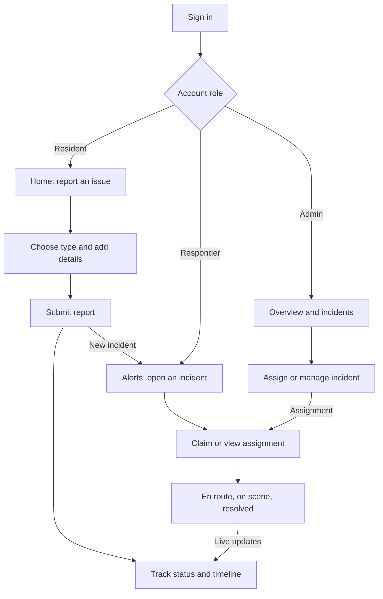

# Kavach

Android app for reporting and handling safety issues in residential societies. Residents, responders and admins use the same Supabase backend.

Built with Kotlin and Jetpack Compose, backed by Supabase Auth, Postgres and Realtime. Room and WorkManager handle pending reports and retries.

| Role | Main tasks |
| --- | --- |
| Resident | Report an issue, track updates, read notices |
| Responder | Claim incidents, update progress, check assets |
| Admin | Assign incidents, manage members and notices, view reports |

## User flow



Residents can also read notices and find contacts. Responders have safety checks, assets and history. Admins manage the team, society, members and notices.

## Stack

| Layer | Tools |
| --- | --- |
| App | Kotlin, Jetpack Compose, Material 3 |
| State and navigation | ViewModel, StateFlow, Navigation Compose, Hilt |
| Backend | Supabase Auth, Postgres, Realtime |
| Pending reports | Room outbox, WorkManager retries |

## Run locally

Requires JDK 17, Gradle 8.11.1 and Android SDK 35. Minimum device version: Android 8.0 (API 26).

1. Open the project in Android Studio and set the SDK path in `local.properties`.
2. Copy `kavach.properties.example` to `kavach.properties`.
3. Fill in the Supabase project URL and publishable key. Never use a secret or service-role key.
4. Build and test:

```sh
gradle :app:testDebugUnitTest :app:assembleDebug
```

`kavach.properties`, signing keys and APKs are git-ignored. There is no Gradle wrapper in this repo; use the Gradle version above.

## Project layout

| Path | Contents |
| --- | --- |
| `app/src/main/java/app/kavach/android/core` | Data, domain rules, navigation and shared UI |
| `app/src/main/java/app/kavach/android/feature` | Resident, responder, admin and shared screens |
| `app/src/test` | Unit tests |
| `supabase` | Round 2 migration and SQL regression checks |
| `.github/workflows/android-release.yml` | Manual arm64 test-release build |

The SQL files are updates for an existing backend, not a complete fresh-project setup. Review them before applying anything to a database.

## Builds

| Build | Package | Signing |
| --- | --- | --- |
| Debug | `app.kavach.android.debug` | Local debug key |
| Test release | `app.kavach.android` | Explicit test key, optimized and non-debuggable |
| Production release | `app.kavach.android` | Owner-provided release key required |

The current [0.1.1 APK](https://github.com/ramnnn2006/kavach-android/releases/tag/v0.1.1) includes the redesign and frosted navigation. Backdrop blur requires Android 12+ with hardware acceleration; other devices use a solid fallback. This is a prototype test release, not a Play Store build. Phone testing is still needed for the full demo flow.
